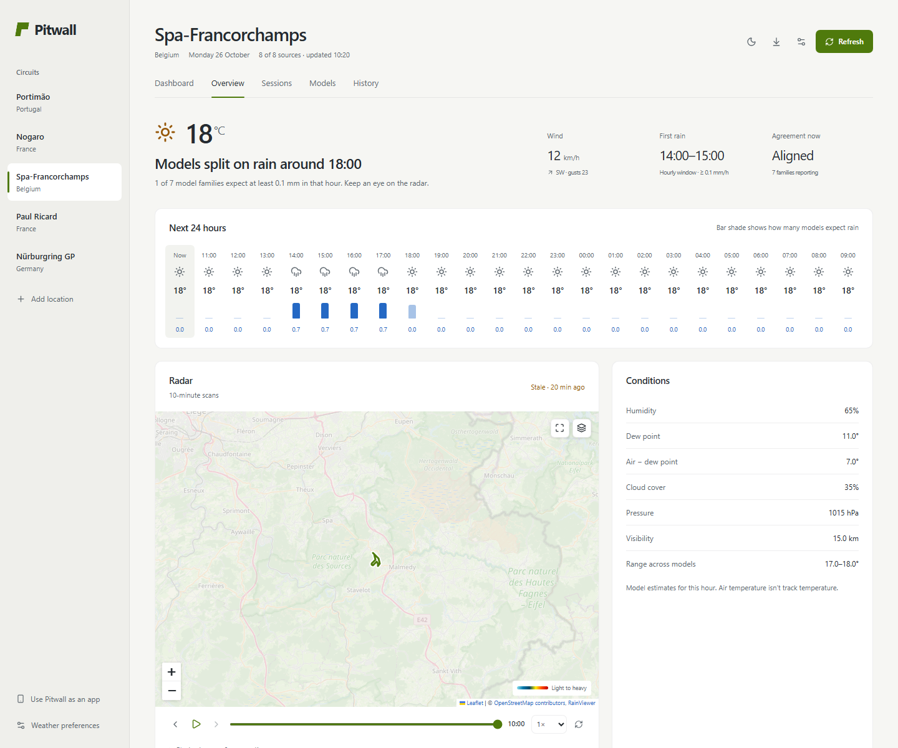

# Pitwall

Compare racetrack forecasts, inspect recent radar over the circuit, and review the weather expected during your sessions.

**A local app for Mac and Windows. No account, Terminal or Node.js installation is needed to use the packaged application.** GitHub holds the source, checks and installer downloads; there is no hosted weather application.



Screenshots and the [short walkthrough](docs/images/walkthrough.webm) use clearly synthetic browser-test data and an example session. They demonstrate the interface; they are not weather reports. The normal application fetches real provider data and has no seeded demo weather.

## Install on your Mac

1. Download the universal **Pitwall `.dmg`** from [Releases](https://github.com/Arthur-Brht/pitwall-/releases).
2. Open the disk image and drag **Pitwall** into **Applications**.
3. Open Pitwall from Applications, Launchpad or the Dock.

The application supports Apple silicon and Intel Macs running **macOS 13 Ventura or newer**. Its runtime and interface are bundled. The local server starts and stops automatically; no browser or terminal window needs to remain open.

**Release status:** previews are labelled `preview` and are ad-hoc signed, not Developer ID signed or Apple notarized. They are build previews, not the standard public installer; the final signing step requires the maintainer's Apple Developer credentials. [Mac installation and release details](docs/MAC_APP.md).

Fresh forecasts, location search, map tiles and radar need internet access. The bundled interface opens offline, with original timestamps on available saved forecasts.

## Install on Windows

1. Download the **Windows x64 setup `.exe`** from [Releases](https://github.com/Arthur-Brht/pitwall-/releases). It supports 64-bit Intel/AMD PCs running Windows 10 or 11.
2. Run the installer and follow the installation wizard. The default is installation for your Windows user.
3. Open **Pitwall** from the Start menu or its desktop shortcut.

The runtime is bundled; PowerShell, Command Prompt, Node.js and a browser window are not needed. Closing the Pitwall window stops the app and its local server.

**Release status:** the Windows preview is unsigned. SmartScreen, Smart App Control or organizational policy may warn or prevent it from running. No Windows protection is disabled by the installer. [Windows installation, storage and verification](docs/WINDOWS_APP.md).

## Run from source (developers)

Install [Node.js 22.13 or newer](https://nodejs.org/en/download), then:

```sh
git clone https://github.com/Arthur-Brht/pitwall-.git pitwall
cd pitwall
npm ci
npm start -- --open
```

The source/browser version runs at **http://localhost:4173/** until stopped with Ctrl+C. Source launchers are also included. Mac app users do not need these commands. [Source setup](docs/RUN_LOCALLY.md).

## Plan a session

1. Choose a circuit, search for a location, or enter coordinates and its timezone.
2. Compare ECMWF IFS, DWD ICON, NOAA GFS and Météo-France through Open-Meteo, alongside MET Norway. Enable or disable feeds to inspect their differences.
3. Use **Session planner** to enter a date, local start time and duration. Inspect each source's rain/gust coverage and the model-dry windows that fit your session.
4. Save and edit plans on this device. Download a calendar file or back up plans and preferences as JSON.

The map shows recent historical radar and attributed circuit outlines where available. **History & sources** records actual fetched predictions for the same valid hour; it exports CSV and can compare those predictions with imported station observations. [Forecast verification method and pilot](docs/FORECAST_VERIFICATION.md).


## What the evidence means

Five feeds use two weather API transports and contain shared model ancestry. Consensus groups related feeds into model families; a wet family vote is a descriptive threshold count, not a calibrated probability. Agreement does not establish accuracy.

Rain refers to the hourly interval beginning at its displayed time. Missing values remain unavailable. Radar is historical, has limited native resolution, and can have gaps; zooming over the track does not create corner-level weather detail. Air temperature and forecast rain do not measure grip, track temperature, standing water or drying rate. [Sources, timing and limits](docs/API_SOURCES.md).

The observation comparison reports sample counts, errors, lead bands and station distance. It rejects forecasts fetched at or after their valid time. A small sample or a nearby station cannot establish track-level accuracy.

## Your data

Circuits, preferences and sessions stay in local storage inside Pitwall's private application profile. Forecast snapshots and caches stay in IndexedDB. Nothing is uploaded to GitHub, synced to another device, or sent to a Pitwall backend. Weather and map providers receive the requested coordinates or map area and normal connection metadata.

The desktop app has a separate profile from Safari, Chrome or Edge. Bring over browser plans/settings by exporting a JSON backup from the old version and importing it in the app's Weather preferences. History exports separately as CSV. Updates preserve the app's profile; keep backups of important plans. [Privacy and storage details](docs/PRIVACY.md).

## Develop and contribute

```sh
npm ci
npm run dev
npm run check
npx playwright install chromium firefox webkit
npm run build
npm run test:e2e
```

Development uses port 5173. Browser tests use isolated contexts on port 4174 with clearly synthetic provider fixtures; they do not touch your saved 4173 data or call public weather services. Chromium, Firefox, WebKit and a mobile viewport exercise the interface. Offline service-worker reload checks run in Chromium.

The stack is React 19, TypeScript, Vite 8, Recharts and locally bundled Leaflet, with a small loopback server. Electron bundles the interface and runtime as Mac and Windows applications. See [architecture](docs/ARCHITECTURE.md), [contributing](CONTRIBUTING.md), [security](SECURITY.md), [verification](docs/VERIFICATION.md) and the [changelog](CHANGELOG.md).

## Licence and data terms

Pitwall's original code and documentation use the [MIT licence](LICENSE). Dependencies, circuit geometry, weather and radar retain their own licences and service conditions; they are **not** relicensed under MIT. Full bundled library notices are generated during build. [Third-party attribution and terms](THIRD_PARTY.md).

Open-Meteo's free service is for non-commercial use within its limits. A public source repository does not grant commercial access to any provider's free API. Check the providers' current terms before redistribution or commercial use.
