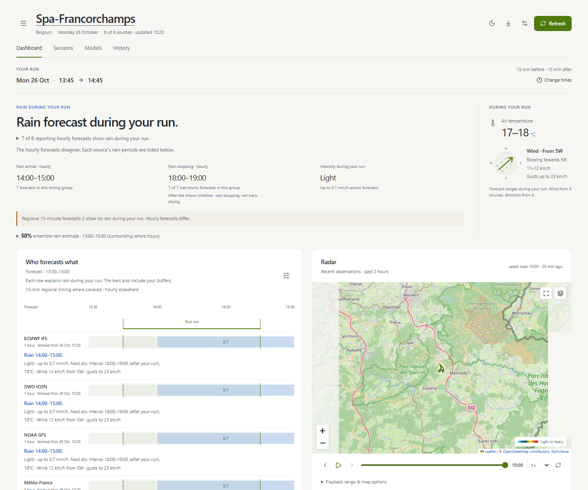
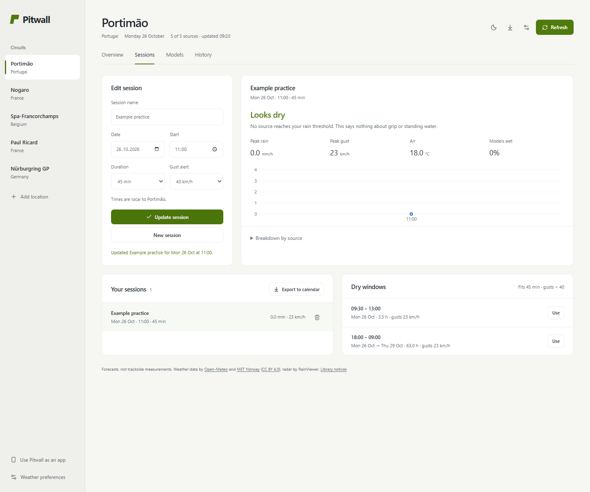

# Pitwall 2.4 Preview

Pitwall is a desktop app for Mac and Windows that helps you plan around the weather at a racetrack. Pick a circuit, and it puts several weather forecasts side by side, shows recent rain radar over the track, and lays out the rain, wind, gusts and temperatures expected during your sessions.

Weather models often disagree, and before a track day or a race weekend it helps to see where they agree and where they don't before deciding when to run. Pitwall is a planning aid. It can't tell you how much grip the track will have, and it can't promise that a session will be dry.

You don't need an account, an API key, Terminal or any other software to use it. You download it, install it and open it like any other app.



[Dark mode](docs/images/dashboard-dark.png) · [Mobile layout](docs/images/dashboard-mobile.png) · [Short walkthrough video](docs/images/walkthrough.webm)

The screenshots and video use made-up example data to show the interface. When you use the app, it shows real forecasts.

## Download

This branch contains the **2.4 comparison preview**. It installs as **Pitwall 2.4 Preview**, alongside the Pitwall 2.3 Preview app, with separate plans, preferences and forecast history. Nothing is copied automatically; export a backup from 2.3 and import it in 2.4 if you want the same plans. History CSV files remain separate.

Download [2.4.3 Preview](https://github.com/CaillouMalade/Pitwall/releases/tag/v2.4.3-preview.1), or keep [2.3 Preview](https://github.com/Arthur-Brht/pitwall/releases/tag/v2.3.0-preview.1) for comparison. The [Releases page](https://github.com/CaillouMalade/Pitwall/releases) keeps the previous versions. This update replaces earlier 2.4 builds in the same app and keeps their plans, preferences and history.

**Mac** (macOS 13 Ventura or newer, Apple silicon or Intel): download the `.dmg`, open it and drag Pitwall 2.4 Preview into Applications. Then open it from Applications, Launchpad or the Dock.

**Windows** (Windows 10 or 11, 64-bit Intel or AMD): download the setup `.exe`, run it and follow the steps. Pitwall 2.4 Preview then appears in the Start menu and on your desktop.

These are preview builds. The Mac app isn't signed with an Apple Developer ID or notarised by Apple, and the Windows app isn't signed either, so your computer may warn you before opening it or block it. The [Mac notes](docs/MAC_APP.md) and [Windows notes](docs/WINDOWS_APP.md) explain what to expect.

## What it does

Pitwall has four main views.

- **Dashboard** focuses on one circuit and your run: rain during it, arrival and clearing windows, intensity, air temperature, wind and gusts. Pick the circuit, date and start/end times in the collapsible sidebar. The timeline includes 15 minutes before and after by default, adjustable separately. Saved sessions can be selected, or Pitwall shows the next three hours. Model timing and recent radar sit together; humidity and charts open on demand. [How to read the dashboard](docs/DASHBOARD.md).
- A short change line appears when earlier saved hourly forecasts cover exactly the same hours. Provider agreement and the ensemble estimate stay separate, with their time bounds shown.
- **Who forecasts what** explains each source's rain periods, next dry interval, temperature, wind and gusts directly below its timing bar, with fetch times and saved-data labels. An animated wind compass names both where the wind comes from and where it blows towards. The hourly wind strip shows changes through the run; calm, missing and conflicting directions stay explicit. Motion can be paused and respects reduced-motion preferences.
- Clearing signals can look beyond your run buffer, with unresolved forecasts counted visibly. Regional-only rain uses clearly labelled regional timing in the main summary. Native 15-minute data are used automatically up to 24 hours ahead where actually supplied; otherwise the timeline says hourly timing only. No extra controls are needed.
- **Sessions** lets you enter a session's date, start time and length, and see what each forecast expects for rain and gusts during it, including any windows where the models expect it to stay dry. You can save and edit your sessions, add them to your calendar, and back them up to a file.
- **Models** opens with an intensity-shaded comparison table, with an optional chart for the same window. Small amounts are enlarged automatically while keeping the light/moderate/heavy guide visible. Light, moderate and heavy rain guides give the charts context. You can switch individual forecasts on or off to see where they differ.
- **History** keeps the forecasts Pitwall has fetched, so you can look back at what was predicted, export it as a CSV file, and compare it with weather station measurements you import.

All 18 known circuits are directly available in the sidebar's Circuit selector, with your saved circuits first. They include Magny-Cours, both Le Mans layouts (La Sarthe and Bugatti), Spa, Portimão, Dijon-Prenois, Paul Ricard and Jarama. Every catalogue circuit has a bundled highlighted outline; loading those outlines does not depend on a live geometry service. You can also search for any place or enter coordinates and a timezone yourself. Light, dark and system appearance are all available. The radar has a taller map, smooth transitions, playback speeds and From/To controls under its map options. It still shows real scans ten minutes apart; blending doesn't add observations between them.



## Where the weather comes from

Eight forecast feeds are enabled by default: ECMWF IFS, DWD ICON, NOAA GFS, Météo-France, UK Met Office, Canada GEM, Japan JMA and MET Norway. Manage forecasts lets you choose what to fetch for each circuit, with KNMI and ItaliaMeteo as extra regional options. Most feeds come through [Open-Meteo](https://open-meteo.com/); MET Norway is contacted directly. Radar comes from RainViewer.

More feeds don't automatically mean more independent opinions. Some models are related, so they can agree and still be wrong. Forecast agreement is a count; the dashboard's separate rain estimate comes from ECMWF, GFS and ICON ensembles, which each contain multiple model runs. It shows their range as well as the middle estimate. Radar shows recent rain rather than a forecast, and zooming in on the track doesn't give you corner-by-corner detail. [More on the sources and their limits](docs/API_SOURCES.md).

The country names identify the agency running each model. Japan's JMA, for example, runs a global model that covers Europe too.

## Your data

Your circuits, sessions, preferences and saved forecasts stay on your computer. Pitwall doesn't upload your plans or history to a hosted service, and there's no cloud sync. Your computer asks the weather and map providers directly for the location you're looking at, so they see that location and ordinary connection details, as any website would.

Pitwall needs internet for fresh forecasts, search, maps and radar. Offline, it still opens and shows any forecasts you already have, labelled with when they were fetched.

To move your plans to another computer, or from an older browser version of Pitwall, export a backup file from Preferences and import it in the app. History is exported separately as a CSV file. [Privacy and storage details](docs/PRIVACY.md).

## Running it from source

This part is only for people who want to work on the code. You need [Node.js 22.13 or newer](https://nodejs.org/en/download).

```sh
git clone --branch preview/2.4 https://github.com/Arthur-Brht/pitwall.git pitwall
cd pitwall
npm ci
npm start -- --open
```

This runs Pitwall in your browser at `http://localhost:4173/` until you stop it with Ctrl+C. See [running locally](docs/RUN_LOCALLY.md) for more.

For development and tests:

```sh
npm ci
npm run dev
npm run check
npx playwright install chromium firefox webkit
npm run build
npm run test:e2e
```

The development server uses port 5173. The browser tests run on port 4174 with made-up weather data, so they don't touch your saved data or call the real weather services.

Pitwall is built with React, TypeScript and Vite, and Electron packages it as a desktop app. More detail is in [architecture](docs/ARCHITECTURE.md), [forecast verification](docs/FORECAST_VERIFICATION.md), [testing and verification](docs/VERIFICATION.md), [contributing](CONTRIBUTING.md), [security](SECURITY.md) and the [changelog](CHANGELOG.md).

## Licence

Pitwall's code and documentation are under the [MIT licence](LICENSE). The weather data, radar, circuit outlines and libraries it uses keep their own licences and terms. See [third-party terms](THIRD_PARTY.md).

Open-Meteo's free service is for non-commercial use within its limits. The code's licence doesn't include commercial access to these providers, so check their terms before redistributing Pitwall or using it commercially.
